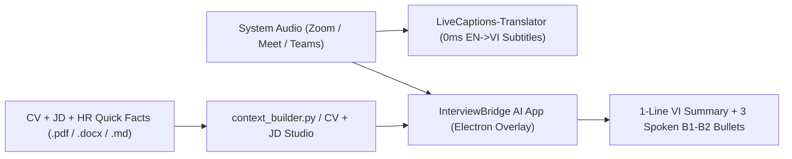

# InterviewBridge AI 🎙️🇻🇳↔🇬🇧

**Real-time Bilingual (`EN → VI`) AI Interview Copilot & Agent Skill grounded in your CV + JD (Windows 11 Ready).**

Trợ lý phỏng vấn tiếng Anh thời gian thực mã nguồn mở cho ứng viên Việt Nam:
- **Nghe & Dịch phụ đề 0ms:** Kết hợp Windows 11 Live Captions (`LiveCaptions-Translator`) để hiển thị phụ đề song ngữ Anh–Việt tức thì ngay dưới webcam.
- **Gợi ý trả lời chuẩn theo CV + JD:** Nạp trực tiếp **CV** (`.pdf`, `.docx`, `.txt`, `.md`) + **Job Description (JD)** + thông tin HR (lương kỳ vọng, notice period, lý do chuyển việc) để AI gợi ý **3 gạch đầu dòng tiếng Anh B1–B2 tự nhiên, dễ nói**, không bịa đặt kinh nghiệm.
- **Chống lộ khi share màn hình:** Cửa sổ overlay trong suốt (`setContentProtection`), luôn nổi cạnh webcam và bật xuyên chuột (`Ctrl + M`).
- **Tích hợp sẵn Agent Skill (`skills/interview-bridge/SKILL.md`):** Dùng được ngay với Claude Code, Antigravity hoặc Cursor để phân tích CV ↔ JD và xuất bộ câu hỏi/trả lời ôn tập trước buổi phỏng vấn.

---

## Kiến trúc hoạt động (Architecture)



---

## Cài đặt nhanh trên Windows 11 (Quickstart)

> Nếu bạn dùng thư mục đã đóng gói sẵn trên máy này thì bỏ qua bước 1 & 2, chỉ cần làm từ **Bước 3**.

1. **Clone repo & cài dependencies:**
   ```powershell
   git clone https://github.com/<your-username>/InterviewBridge-AI.git
   cd InterviewBridge-AI
   .\setup.ps1
   ```
2. **Bật Windows 11 Live Captions (chỉ làm 1 lần):**
   - Nhấn **`Win + Ctrl + L`**, chọn tải gói giọng nói **English (United States)**.
3. **Lấy Gemini API Key miễn phí:**
   - Tạo key tại [Google AI Studio](https://aistudio.google.com/apikey) (hoặc dùng Groq / Local Whisper + GGUF ngay trong app).
4. **Khởi chạy 1-click:**
   - Double-click **[start.bat](start.bat)** để mở đồng thời `LiveCaptionsTranslator.exe` và `InterviewBridge AI`.

---

## 3 cách nạp CV + JD cho AI trả lời chuẩn chỉ

### Cách 1: Nạp trực tiếp trong App (`CV + JD Studio`) — Khuyên dùng
1. Mở app bằng `start.bat` -> chọn tab **CV + JD Studio** ở thanh bên trái.
2. Chọn chế độ phỏng vấn:
   - **`HR Screening (EN → VI + Simple B1-B2)`**: Dịch 1 dòng tiếng Việt + 3 ý tiếng Anh giao tiếp ngắn (8–14 từ/ý), bám sát thông tin HR.
   - **`Technical Interview (EN → VI + Tech/STAR)`**: Tập trung vào kiến trúc, tech stack trong CV và yêu cầu kỹ thuật trong JD.
3. Điền 4 ô **HR Quick Facts** (*Role & Company*, *Expected Salary*, *Notice Period*, *Reason for Leaving*).
4. Bấm **`Import File (.pdf/.docx/.txt/.md)`** để nạp thẳng file CV và JD (hoặc dán text trực tiếp). Mọi thay đổi được tự động lưu ngay lập tức.

### Cách 2: Thả file vào `user-data/` để tự đồng bộ khi mở app
1. Đặt file CV của bạn thành `user-data/cv.pdf` (hoặc `.docx`, `.md`, `.txt`) và JD thành `user-data/jd.pdf`.
2. (Tuỳ chọn) Copy `user-data/profile.example.json` thành `user-data/profile.json` và điền thông tin HR của bạn.
3. Chạy `start.bat` — script `scripts/context_builder.py --auto-sync` sẽ tự trích xuất toàn bộ CV + JD và nạp thẳng vào cấu hình app trước khi Electron mở lên.

> 🔒 **Bảo mật cá nhân:** Thư mục `user-data/*` (trừ các file `*.example.*`) đã được cấu hình trong `.gitignore`, nên CV/JD thật của bạn **không bao giờ bị push nhầm lên GitHub**.

### Cách 3: Dùng qua AI Agent Skill (`skills/interview-bridge/SKILL.md`)
Cài hoặc trỏ AI Coding Agent của bạn (Claude Code / Antigravity / Cursor) tới `skills/interview-bridge/SKILL.md`, sau đó nhắn:
> *"Dùng skill interview-bridge đọc CV và JD này, đồng bộ vào app và tạo cho tôi bộ cheatsheet trả lời phỏng vấn HR tiếng Anh."*

---

## Cách Test chuẩn & Phím tắt thực chiến

- **Cách test âm thanh tại nhà:** Trên Windows, app thu **Loopback Audio** (tiếng phát ra từ loa/tai nghe), không thu tiếng bạn tự nói vào mic. Hãy mở một video YouTube *"HR English Mock Interview"*, nhấn **Start Session** và xem app tự bắt câu hỏi + gợi ý trả lời theo đúng CV/JD của bạn.
- **Đặt cửa sổ ngay dưới Webcam:** Dùng phím tắt để mắt luôn hướng gần camera:
  - **`Ctrl + Phím mũi tên`**: Di chuyển cửa sổ overlay lên sát mép trên màn hình.
  - **`Ctrl + M`**: Bật/tắt chế độ **Click-through** (xuyên chuột xuống Zoom/Meet/Teams).
  - **`Ctrl + \`**: Ẩn/hiện nhanh cửa sổ.
  - **`Ctrl + Enter`**: Gửi ảnh chụp màn hình + hỏi AI bước tiếp theo.

---

## Cấu trúc thư mục (Repository Layout)

```text
InterviewBridge-AI/
├── app/                         # Electron Desktop App (Overlay + CV & JD Studio)
├── scripts/
│   └── context_builder.py       # Trích xuất PDF/DOCX/MD/TXT & đồng bộ cấu hình app
├── skills/
│   └── interview-bridge/
│       └── SKILL.md             # Agent Skill cho Claude Code / Antigravity / Cursor
├── user-data/                   # Chỗ thả cv.*, jd.*, profile.json (git-ignored)
│   ├── cv.example.md
│   ├── jd.example.md
│   └── profile.example.json
├── bin/                         # Nơi chứa LiveCaptionsTranslator.exe (git-ignored)
├── setup.ps1                    # Script cài đặt cho máy clone mới từ GitHub
├── start.bat                    # Khởi chạy 1-click (Auto-sync + LiveCaptions + App)
└── LICENSE                      # GPL-3.0
```

---

## Credits & License

Dự án phát triển và tùy biến dựa trên các dự án mã nguồn mở GPL-3.0 tuyệt vời:
- [`sohzm/cheating-daddy`](https://github.com/sohzm/cheating-daddy) — Real-time Gemini Live / Groq / Local AI overlay architecture.
- [`SakiRinn/LiveCaptions-Translator`](https://github.com/SakiRinn/LiveCaptions-Translator) — Ultra-low-latency Windows 11 Live Captions translator.

Licensed under the [GNU General Public License v3.0](LICENSE).
