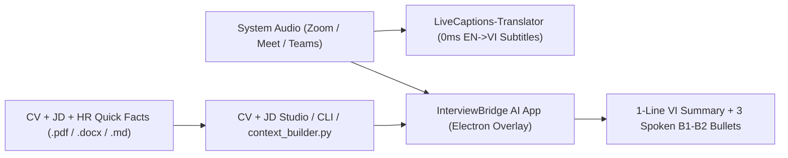

# InterviewBridge AI 🎙️🇻🇳↔🇬🇧

**Real-time Bilingual (`EN → VI`) AI Interview Copilot, CLI & Agent Skill grounded in your CV + JD (Windows 11 Ready).**

Trợ lý phỏng vấn tiếng Anh thời gian thực mã nguồn mở cho ứng viên Việt Nam:
- **Nghe & Dịch phụ đề 0ms:** Kết hợp Windows 11 Live Captions (`LiveCaptions-Translator`) để hiển thị phụ đề song ngữ Anh–Việt tức thì ngay dưới webcam.
- **Gợi ý trả lời chuẩn theo CV + JD:** Nạp trực tiếp **CV** (`.pdf`, `.docx`, `.txt`, `.md`) + **Job Description (JD)** + thông tin HR (lương kỳ vọng, notice period, lý do chuyển việc) để AI gợi ý **3 gạch đầu dòng tiếng Anh B1–B2 tự nhiên, dễ nói**, không bịa đặt kinh nghiệm.
- **Chống lộ khi share màn hình:** Cửa sổ overlay trong suốt (`setContentProtection`), luôn nổi cạnh webcam và bật xuyên chuột (`Ctrl + M`).
- **Tích hợp sẵn CLI & Agent Skill (`skills/interview-bridge/SKILL.md`):** Dùng qua `npx`, PowerShell 1 dòng, file `.exe` cài đặt trực tiếp hoặc qua Claude Code / Antigravity / Cursor.

---

## 4 cách cài đặt cực nhanh (Choose your install path)

### Cách 1: Chạy bảng điều khiển CLI / Cài Skill qua `npx` (Khuyên dùng)
```powershell
# Mở bảng điều khiển CLI tương tác (Cài Skill / Tải .exe / Nạp CV + JD)
npx github:khoazandev/InterviewBridge-AI

# Hoặc chạy lệnh trực tiếp:
npx github:khoazandev/InterviewBridge-AI skill        # Cài Agent Skill vào ~/.agents & ~/.claude
npx github:khoazandev/InterviewBridge-AI install-app  # Tải & cài bộ đôi .exe trên Windows 11
npx github:khoazandev/InterviewBridge-AI context --cv cv.docx --jd jd.md --role "Backend @ Acme"
```
*(Nếu dùng `skills` CLI: `npx skills add khoazandev/InterviewBridge-AI`)*

### Cách 2: Cài 1 dòng trên Windows 11 PowerShell
```powershell
irm https://raw.githubusercontent.com/khoazandev/InterviewBridge-AI/main/install.ps1 | iex
```
Lệnh này tự động cài Agent Skill, tải `InterviewBridge-AI-Setup.exe` + `LiveCaptionsTranslator.exe`, tạo shortcut `Launch-InterviewBridge.bat` ngoài Desktop và chạy bộ cài `.exe`.

### Cách 3: Tải thẳng file `.exe` từ GitHub Releases
Truy cập [Releases](https://github.com/khoazandev/InterviewBridge-AI/releases/latest) và tải:
- **`InterviewBridge-AI-Setup.exe`** — Bộ cài Windows cho ứng dụng desktop (`CV + JD Studio` + Overlay AI).
- **`LiveCaptionsTranslator.exe`** — Phụ đề dịch Anh $\rightarrow$ Việt thời gian thực dựa trên Windows 11 Live Captions.

### Cách 4: Chạy từ mã nguồn (Developer)
```powershell
git clone https://github.com/khoazandev/InterviewBridge-AI.git
cd InterviewBridge-AI
.\setup.ps1
```
Sau đó mở app bằng `start.bat`.

---

## Kiến trúc hoạt động (Architecture)



---

## Thiết lập lần đầu (chỉ mất 2 phút)

1. **Bật Windows 11 Live Captions (chỉ làm 1 lần):**
   - Nhấn **`Win + Ctrl + L`**, chọn tải gói ngôn ngữ **English (United States)**.
2. **Lấy Gemini API Key miễn phí:**
   - Tạo key tại [Google AI Studio](https://aistudio.google.com/apikey) (hoặc dùng Groq / Local Whisper + GGUF ngay trong app).
3. **Nạp CV + JD cho AI trả lời chuẩn chỉ (3 cách):**
   - **Trong App (`CV + JD Studio`):** Chọn chế độ `HR Screening (EN → VI + Simple B1-B2)` hoặc `Technical Interview`, điền 4 ô **HR Quick Facts**, rồi bấm **`Import File (.pdf/.docx/.txt/.md)`**. *(File `.docx`, `.txt`, `.md` hoạt động thuần offline trong `.exe` không cần Python; file `.pdf` dùng Python + `pypdf`.)*
   - **Qua CLI (`npx`):** `npx github:khoazandev/InterviewBridge-AI context --cv <file> --jd <file> --role "..." --salary "..."`
   - **Thả vào `user-data/` (`start.bat`):** Đặt `user-data/cv.pdf` + `user-data/jd.pdf` + `user-data/profile.json` rồi chạy `start.bat`.

> 🔒 **Bảo mật cá nhân:** Thư mục `user-data/*` (trừ `*.example.*`) đã nằm trong `.gitignore`, CV/JD thật của bạn không bao giờ bị đẩy nhầm lên GitHub.

---

## Cách Test chuẩn & Phím tắt thực chiến

- **Test âm thanh tại nhà:** Trên Windows, app thu **Loopback Audio** (âm thanh phát ra từ loa/tai nghe), không thu tiếng bạn tự nói vào mic. Hãy mở một video YouTube *"HR English Mock Interview"*, nhấn **Start Session** và xem app tự bắt câu hỏi + gợi ý trả lời theo đúng CV/JD của bạn.
- **Phím tắt đặt cửa sổ sát dưới Webcam:**
  - **`Ctrl + Phím mũi tên`**: Di chuyển cửa sổ overlay lên sát mép trên màn hình.
  - **`Ctrl + M`**: Bật/tắt chế độ **Click-through** (xuyên chuột xuống Zoom/Meet/Teams).
  - **`Ctrl + \`**: Ẩn/hiện nhanh cửa sổ.
  - **`Ctrl + Enter`**: Gửi ảnh chụp màn hình + hỏi AI bước tiếp theo.

---

## Cấu trúc thư mục (Repository Layout)

```text
InterviewBridge-AI/
├── app/                         # Electron Desktop App (Overlay + CV & JD Studio)
├── cli/
│   └── index.js                 # Bảng điều khiển CLI & trình cài Skill (zero dependencies)
├── scripts/
│   └── context_builder.py       # Trích xuất PDF/DOCX/MD/TXT & đồng bộ cấu hình app
├── skills/
│   └── interview-bridge/
│       └── SKILL.md             # Agent Skill cho Claude Code / Antigravity / Cursor
├── user-data/                   # Template CV/JD/Profile (dữ liệu thật được git-ignore)
├── install.ps1                  # Script cài 1 dòng trên Windows 11 (irm ... | iex)
├── setup.ps1                    # Script cài đặt khi clone source từ GitHub
├── start.bat                    # Khởi chạy 1-click (Auto-sync + LiveCaptions + App)
├── package.json                 # Root package cho npx github:khoazandev/InterviewBridge-AI
└── LICENSE                      # GPL-3.0
```

---

## Credits & License

Dự án phát triển và tùy biến dựa trên các dự án mã nguồn mở GPL-3.0:
- [`sohzm/cheating-daddy`](https://github.com/sohzm/cheating-daddy) — Real-time Gemini Live / Groq / Local AI overlay architecture.
- [`SakiRinn/LiveCaptions-Translator`](https://github.com/SakiRinn/LiveCaptions-Translator) — Ultra-low-latency Windows 11 Live Captions translator.

Licensed under the [GNU General Public License v3.0](LICENSE).
